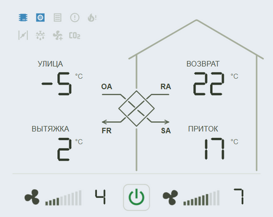

# Royal Clima ERV Card

[Русский](README.ru.md)

A Home Assistant dashboard card intended for monitoring and controlling a Royal Clima SOFFIO Primo ventilation unit connected through an ESP32 running ESPHome. The card is under development and provides a control panel with temperatures, status indicators, power control and fan step selection. Firmware, hardware wiring instructions and dashboard examples are available in the main repository: [ESPHome-RoyalClima](https://github.com/alidonet/ESPHome-RoyalClima).

Example cards from the firmware repository (Russian labels):




## Card configuration

All card settings are optional. YAML only needs Home Assistant's card type identifier:

```yaml
type: custom:royal-clima-card
```

Options can be set independently. In the control view, transparency requires compact mode; in the airflow view, it works independently of compact mode. The card uses the default entity IDs below when those entities exist in HA.

| Option | Type / default | Purpose |
|---|---|---|
| `flow_colors` | string, `fixed` | Airflow colors: `fixed` for original colors, `temperature` for the −30…+40 °C palette. |
| `view` | string, `control` | `control` for the control panel; `airflow` for the airflow diagram. |
| `prefix` | string, `ventilation_system` | Prefix for ventilation entities. |
| `esp_prefix` | string, `royal_clima` | Prefix for ESP32 diagnostics and the filter reminder. |
| `entities` | mapping, `{}` | Individual entity ID overrides; see the table below. |
| `entity` | string or `null`, unset | Compatibility with the first test version: overrides only the supply temperature sensor. `entities.supply_temperature` takes precedence. |
| `name` | string, `Royal Clima ERV` | Accessible card name (aria-label), without a visible heading. An empty string falls back to the default. |
| `language` | string, HA language | Language of card labels, tooltips and dialogs; see below. |
| `compact` | boolean, `false` | In the control view, removes the case and bottom button row, retaining the screen and controls on it. Ignored in the airflow view. |
| `transparent` | boolean, `false` | Removes the background. Requires `compact: true` in the control view; works independently in the airflow view. |
| `sensor_boost_icon` | string, `co2` | Sensor boost icon: `none` hides it, `co2` shows CO₂, `humidity` shows a water drop. |
| `show_fire_alarm` | boolean, `true` | Show the fire input indicator. |
| `show_external_input_boost` | boolean, `true` | Show the external input boost indicator. |


### Language and appearance

When `language` is omitted, the card follows the HA profile language: Russian (including `ru-*` variants) uses Russian labels; all other languages use English. Set `language: ru` or `language: en` to force a language independently of the profile. Any other explicitly supplied string, including `auto`, selects English; remove the option to restore automatic selection. This setting does not change firmware messages or entity names.

In compact mode, tapping a speed block opens step selection instead of history; the power icon at the bottom of the screen toggles power. Normal mode uses the bottom button row for these controls.

In the control view, `transparent: true` with `compact: true` hides the screen background while retaining the divider above the fans, revealing the dashboard behind the content. Readings and icons remain opaque; their colors do not automatically adapt to the theme. In this view, `transparent` has no effect with `compact: false`. In the airflow view, transparency works independently of `compact`. Use unquoted YAML booleans `true` / `false`.

```yaml
type: custom:royal-clima-card
language: en
compact: true
transparent: true
```

### Entities

Every key inside `entities` is optional. Set a full `entity_id` to override the generated ID, or `null` to disable its binding. Omitted keys retain their defaults. Overrides take precedence over prefixes and `entity`; `null` does not remove the corresponding panel element, except for the preheater icon.

Supply prefixes without the domain or trailing underscore, for example `prefix: ventilation_system`. Surrounding whitespace and trailing underscores are stripped. Lowercase ASCII letters, digits and underscores are accepted.

The table shows full IDs with the default prefixes:

| Key in `entities` | Default | Purpose |
|---|---|---|
| `preheater` | `null` | Preheater active; bind explicitly if available. |
| `outdoor_temperature` | `sensor.ventilation_system_outdoor_air_temperature` | Outdoor air temperature. |
| `return_temperature` | `sensor.ventilation_system_return_air_temperature` | Return air temperature. |
| `defrost_temperature` | `sensor.ventilation_system_defrost_temperature` | Defrost sensor temperature, displayed as EXHAUST. |
| `supply_temperature` | `sensor.ventilation_system_supply_air_temperature` | Supply air temperature (SA). |
| `exhaust_speed` | `sensor.ventilation_system_exhaust_fan_speed` | Exhaust fan step, 0–10. |
| `exhaust_speed_control` | `select.ventilation_system_exhaust_speed_control` | Select entity for setting the exhaust step. |
| `supply_speed_control` | `select.ventilation_system_supply_speed_control` | Select entity for setting the supply step. |
| `supply_speed` | `sensor.ventilation_system_supply_fan_speed` | Supply fan step, 0–10. |
| `power` | `binary_sensor.ventilation_system_ventilation_power` | Actual ventilation power state. |
| `power_control` | `switch.ventilation_system_ventilation_control` | Switch entity for power commands. |
| `online` | `binary_sensor.ventilation_system_vent_system_online` | Ventilation / Modbus connection. |
| `esp_connection` | `binary_sensor.royal_clima_esp32_connection` | ESP32 connection. |
| `error` | `binary_sensor.ventilation_system_ventilation_error` | Ventilation error flag. |
| `fire_alarm` | `binary_sensor.ventilation_system_fire_alarm` | Fire input. |
| `bypass` | `binary_sensor.ventilation_system_bypass_open` | Bypass open. |
| `defrost` | `binary_sensor.ventilation_system_defrost_active` | Defrost active. |
| `external_input_boost` | `binary_sensor.ventilation_system_external_input_boost_active` | External boost active. |
| `sensor_boost` | `binary_sensor.ventilation_system_sensor_boost_active` | CO₂ or humidity sensor boost flag; not a ppm or humidity measurement. |
| `filter_replacement` | `binary_sensor.royal_clima_filter_replacement_recommended` | Filter replacement reminder. |

For example, to use existing control wrappers and your own preheater sensor:

```yaml
type: custom:royal-clima-card
entities:
  power_control: switch.royal_clima_power
  supply_speed_control: select.royal_clima_supply_speed
  exhaust_speed_control: select.royal_clima_exhaust_speed
  preheater: binary_sensor.my_preheater_active
```

Readings and controls are separate: `power` / `power_control`, `supply_speed` / `supply_speed_control`, and `exhaust_speed` / `exhaust_speed_control`. Power control requires a `switch`; fan step selection requires a `select` with options `0`–`10` (unavailable options are disabled). Speeds represent steps, not RPM or percentages. The preheater is unbound by default: its icon is hidden unless an entity is explicitly configured.

### Sensor boost

`sensor_boost_icon` changes only the icon and tooltip; the card cannot detect the connected sensor type. State and history use `entities.sensor_boost`. `none` hides both the icon and its click area. The flag is not a CO₂ or humidity measurement.

```yaml
sensor_boost_icon: humidity
entities:
  sensor_boost: binary_sensor.ventilation_system_sensor_boost_active
  external_input_boost: binary_sensor.ventilation_system_external_input_boost_active
```

When upgrading, rename entity override keys `co2_boost` → `sensor_boost` and `external_boost` → `external_input_boost`. Generated IDs match the updated firmware. For older firmware, explicitly bind the previous entity IDs using the new keys.

The fire input and external input boost indicators are shown by default. Setting `show_fire_alarm: false` or `show_external_input_boost: false` hides the corresponding indicator, click area and keyboard focus without changing entity states or bindings.

```yaml
show_fire_alarm: false
show_external_input_boost: false
```

The heat exchanger diamond outline turns red when `entities.error` is active and the ventilation unit is connected. This firmware binary sensor represents a nonzero error code; the raw code sensor does not need to be enabled. The normal color returns when the error clears; loss of connection makes the outline pale.

### Airflow diagram


```yaml
type: custom:royal-clima-card
view: airflow
transparent: false
```

The default remains `control`. The airflow view keeps the previous diagram geometry and supports shared entity bindings, language, history, power and fan controls with confirmation, error notices, animated fans, preheater and optional indicators. Speed readings open history; the surrounding bottom buttons open speed selection.

`transparent: true` works independently of `compact`; `compact` is ignored in the airflow view. No external SVG assets, fonts or third-party cards are required.


`flow_colors: temperature` maps airflow lines and arrows to a shared blue-violet → blue → cyan → green → orange → red scale from −30 to +40 °C. Gradients include intermediate palette colors. Colors clamp outside this range; readings do not. A flow falls back to its original colors if either endpoint temperature is unavailable. Labels and readings keep their original styling.
