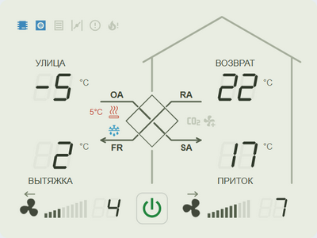
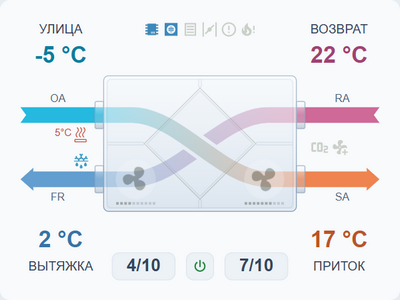
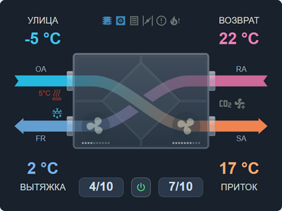

# Royal Clima ERV Card

[Русский](README.ru.md)

A Home Assistant card for Royal Clima SOFFIO Primo ventilation units: temperatures, status indicators, power control and fan step selection. Two views: a control panel and an airflow diagram. ESPHome firmware for ESP32 and hardware wiring instructions: [ESPHome-RoyalClima](https://github.com/alidonet/ESPHome-RoyalClima).







## Installation

1. Connect the ESP32 running the firmware to Home Assistant through the ESPHome integration.
2. In HACS, open **Custom repositories**, add `https://github.com/alidonet/ha-royal-clima-card` with the **Dashboard** category and install **Royal Clima ERV Card**.
3. If the resource was not added automatically, add `/hacsfiles/ha-royal-clima-card/ha-royal-clima-card.js` to your dashboard resources as a **JavaScript module**.
4. Reload the browser page and add the card through the card picker or manually in YAML.

Without HACS: copy [dist/ha-royal-clima-card.js](dist/ha-royal-clima-card.js) to `/config/www/ha-royal-clima-card.js`, add `/local/ha-royal-clima-card.js` as a **JavaScript module** resource and reload the page.

## Minimal configuration

Only `type` is required. All other settings and entity bindings are optional.

```yaml
type: custom:royal-clima-card
```

## Full configuration

All settings are shown below with their defaults and English explicitly selected (`language: auto`). Without `language`, the card follows the HA profile language. Usually the minimal YAML or a change of prefixes is enough. Explicit `entities` override prefixes: if you copy the full example, update the corresponding entity IDs too.

```yaml
type: custom:royal-clima-card
view: control
prefix: vent
esp_prefix: royalclima
transparent: false
flow_colormap: false
sensor_boost_co2: true

language: auto

show_icons:
  api_connected: true
  online: true
  filter_usage: true
  bypass: true
  fault: true
  fire_alarm: true
  preheater: true
  defrost: true
  sensor_boost: true
  external_boost: true

entities:
  uptime: sensor.royalclima_uptime
  wifi_signal: sensor.royalclima_wifi_signal
  data_age: sensor.vent_data_age
  offline_count: sensor.vent_offline_count
  fan_runtime: sensor.vent_runtime
  filter_interval: sensor.vent_filter_interval
  status: sensor.vent_status
  fault_details: sensor.vent_fault_details
  humidity_target: sensor.vent_humidity_target
  heater_target: sensor.vent_heater_target
  outdoor_temp: sensor.vent_outdoor_temp
  return_temp: sensor.vent_return_temp
  exhaust_temp: sensor.vent_exhaust_temp
  supply_temp: sensor.vent_supply_temp
  exhaust_speed: sensor.vent_exhaust_speed
  exhaust_speed_control: select.vent_exhaust_speed
  supply_speed_control: select.vent_supply_speed
  supply_speed: sensor.vent_supply_speed
  power: binary_sensor.vent_power
  power_control: switch.vent_power
  online: binary_sensor.vent_online
  api_connected: binary_sensor.royalclima_api_connected
  fault: binary_sensor.vent_fault
  fire_alarm: binary_sensor.vent_fire_alarm
  bypass: binary_sensor.vent_bypass_open
  defrost: binary_sensor.vent_defrost
  external_boost: binary_sensor.vent_external_boost
  sensor_boost: binary_sensor.vent_sensor_boost
  filter_usage: sensor.vent_filter_usage
  preheater: null
```

## Parameters

| Parameter | Value / purpose |
|---|---|
| `type` | Required: `custom:royal-clima-card`. |
| `view` | `control` — control panel; `airflow` — airflow diagram. |
| `prefix`, `esp_prefix` | Ventilation and ESP32 entity prefixes: `vent`, `royalclima`. Omit the domain; lowercase ASCII letters, digits and underscores are accepted. |
| `theme` | `auto` by default follows HA; `light` / `dark` force a theme. Falls back to the system preference when HA theme information is unavailable. |
| `language` | `auto` by default follows HA; `ru` / `en` force a language. Other values select English. |
| `transparent` | `false`; `true` removes the background. Text and icon colors follow the selected theme. |
| `flow_colormap` | `false` — standard flow colors; `true` — temperature palette. |
| `sensor_boost_co2` | `true` — CO₂ icon; `false` — humidity icon. Changes the icon and tooltip; does not detect the sensor type. |
| `show_icons` | All icons are enabled. Set a key from the full YAML to `false` to hide its icon and click area. Entity state is unchanged. |
| `entities` | Full entity ID overrides. Omitted keys are generated from the prefixes; `null` disables a binding. Keys are listed below. |

### Entity bindings

Domains and full default IDs are shown in the YAML above. Readings and controls are bound separately: `power_control` must be a `switch`, and `*_speed_control` must be a `select` with numeric string options `0`–`10`.

| Keys in `entities` | Purpose |
|---|---|
| `outdoor_temp`, `return_temp`, `supply_temp`, `exhaust_temp` | Outdoor, return, supply and exhaust air temperatures. |
| `supply_speed`, `exhaust_speed` | Actual supply and exhaust fan steps, integers from 0 to 10. |
| `supply_speed_control`, `exhaust_speed_control` | Supply and exhaust fan step selection. |
| `power`, `power_control` | Actual power state and power control switch. |
| `api_connected`, `online` | HA-to-ESP32 connection and ESP32-to-ventilation connection over Modbus. |
| `fault`, `fault_details`, `status` | Error flag, error description and ventilation status text. |
| `bypass`, `defrost`, `fire_alarm` | Open bypass, defrost and fire input. |
| `sensor_boost`, `external_boost` | Sensor boost and external input boost. |
| `preheater`, `heater_target` | Preheater state and heater setpoint. `preheater` is unbound by default (`null`). |
| `filter_usage`, `filter_interval`, `fan_runtime` | Filter usage percentage, configured reminder interval and fan operating hours. |
| `humidity_target` | Humidity setpoint. |
| `uptime`, `wifi_signal`, `data_age`, `offline_count` | ESP32 uptime in seconds, Wi-Fi signal, time since the last data and connection loss count; used in tooltips. |

If you use custom control wrappers, set them in `entities.power_control`, `entities.supply_speed_control` and `entities.exhaust_speed_control`. Unavailable extra data is omitted from tooltips.

## Display behavior

- The display changes for bypass, an unavailable or powered-off unit, defrost, preheating and boost. Fan animation speed follows the fan steps.
- Tapping a temperature, indicator or fan opens entity details and history. In the control panel, speed digits and bars open step selection; in the airflow diagram, use the bottom control tiles. Speed changes require the unit to be powered on and connected; commands wait up to 20 seconds for confirmation.
- Filter icon: below 80% — green; 80% to below 100% — orange; 100% and above — red. With no data, the color does not indicate a healthy state.
- The temperature palette covers −30…+40 °C. Outside this range, only the color is clamped. If an endpoint temperature is unavailable, the flow uses its standard colors.
  
