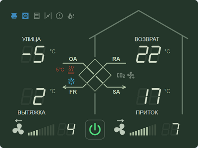
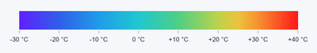

# Royal Clima ERV Card

[](https://github.com/alidonet/ha-royal-clima-card/actions/workflows/hacs.yml?query=branch%3Amain)
[](https://my.home-assistant.io/redirect/hacs_repository/?owner=alidonet&repository=ha-royal-clima-card&category=plugin)
[](https://github.com/alidonet/ha-royal-clima-card/releases/latest)
[](https://github.com/alidonet/ha-royal-clima-card/releases)

[Русский](README.ru.md)

A Home Assistant card for Royal Clima SOFFIO Primo ventilation units: temperatures, status indicators, power control and fan step selection. Two views: a control panel and an airflow diagram. ESPHome firmware for ESP32 and hardware wiring instructions: [ESPHome-RoyalClima](https://github.com/alidonet/ESPHome-RoyalClima).





## Installation

[](https://my.home-assistant.io/redirect/hacs_repository/?owner=alidonet&repository=ha-royal-clima-card&category=plugin)

1. Connect the ESP32 running the firmware to Home Assistant through the ESPHome integration.
2. In HACS, search for **Royal Clima ERV Card** and install it from the **Dashboard** category.
3. If the resource was not added automatically, add `/hacsfiles/ha-royal-clima-card/ha-royal-clima-card.js` to your dashboard resources as a **JavaScript module**.
4. Reload the browser page and add the card through the card picker or manually in YAML.

Without HACS: copy [dist/ha-royal-clima-card.js](dist/ha-royal-clima-card.js) to `/config/www/ha-royal-clima-card.js`, add `/local/ha-royal-clima-card.js` as a **JavaScript module** resource and reload the page.

## Minimal configuration

Only `type` is required. All other settings and entity bindings are optional.

```yaml
type: custom:royal-clima-card
```

## Visual editor

Configure the card in the HA editor: view, prefixes, theme, language, appearance and icon visibility. The expandable advanced entities section provides standard entity pickers. Empty fields use automatic bindings; preheating is hidden without a sensor. YAML editing remains available. Editor labels follow the HA profile language.

## Full configuration

All settings are shown below with their defaults and English explicitly selected (`language: auto`). Without `language`, the card follows the HA profile language. Usually the minimal YAML or a change of prefixes is enough. Explicit `entities` override prefixes: if you copy the full example, update the corresponding entity IDs too.

```yaml
type: custom:royal-clima-card
view: control
prefix: vent
esp_prefix: royalclima
transparent: false
flow_colormap: false
show_recovery: true
show_recovery_info: false
sensor_boost_co2: true

language: auto

show_icons:
  api_connected: true
  online: true
  filter_usage: true
  bypass: true
  fault: true
  fire_alarm: true
  preheater: true
  defrost: true
  sensor_boost: true
  external_boost: true

entities:
  uptime: sensor.royalclima_uptime
  wifi_signal: sensor.royalclima_wifi_signal
  data_age: sensor.vent_data_age
  offline_count: sensor.vent_offline_count
  fan_runtime: sensor.vent_runtime
  filter_interval: sensor.vent_filter_interval
  status: sensor.vent_status
  fault_details: sensor.vent_fault_details
  humidity_target: number.vent_humidity_target
  heater_target: number.vent_heater_target
  outdoor_temp: sensor.vent_outdoor_temp
  return_temp: sensor.vent_return_temp
  exhaust_temp: sensor.vent_exhaust_temp
  supply_temp: sensor.vent_supply_temp
  exhaust_speed: select.vent_exhaust_speed
  exhaust_speed_control: select.vent_exhaust_speed
  supply_speed_control: select.vent_supply_speed
  supply_speed: select.vent_supply_speed
  power: switch.vent_power
  power_control: switch.vent_power
  online: binary_sensor.vent_online
  api_connected: binary_sensor.royalclima_api_connected
  fault: binary_sensor.vent_fault
  fire_alarm: binary_sensor.vent_fire_alarm
  bypass: binary_sensor.vent_bypass_open
  defrost: binary_sensor.vent_defrost
  external_boost: binary_sensor.vent_external_boost
  sensor_boost: binary_sensor.vent_sensor_boost
  filter_usage: sensor.vent_filter_usage
  preheater: ""
```

## Parameters

| Parameter | Value / purpose |
|---|---|
| `type` | Required: `custom:royal-clima-card`. |
| `view` | `control` — control panel; `airflow` — airflow diagram. |
| `prefix`, `esp_prefix` | Ventilation and ESP32 entity prefixes: `vent`, `royalclima`. Omit the domain; lowercase ASCII letters, digits and underscores are accepted. |
| `theme` | `auto` by default follows HA; `light` / `dark` force a theme. Falls back to the system preference when HA theme information is unavailable. |
| `language` | `auto` by default follows HA; `ru` / `en` force a language. Other values select English. |
| `transparent` | `false`; `true` removes the background. Text and icon colors follow the selected theme. |
| `show_recovery_info` | `false`; `true` adds a transparent clickable explanation row below the card. |
| `show_recovery` | `true` — show temperature recovery percentage in the exchanger center. |
| `flow_colormap` | `false` — standard flow colors; `true` — temperature palette. |
| `sensor_boost_co2` | `true` — CO₂ icon; `false` — humidity icon. Changes the icon and tooltip; does not detect the sensor type. |
| `show_icons` | All icons are enabled. Set a key from the full YAML to `false` to hide its icon and click area. Entity state is unchanged. |
| `entities` | Full entity ID overrides. Omitted keys are generated from the prefixes; Empty fields use the default entity ID. Keys are listed below. |

### Entity bindings

Domains and full default IDs are shown in the YAML above. By default, readings and commands use the same entity: `power` and `power_control` share a `switch`; each speed and its `*_control` share a `select` with numeric string options `0`–`10`. Setpoints use `number` entities, disabled by default in the firmware. Separate feedback bindings remain optional overrides.

| Keys in `entities` | Purpose |
|---|---|
| `outdoor_temp`, `return_temp`, `supply_temp`, `exhaust_temp` | Outdoor, return, supply and exhaust air temperatures. |
| `supply_speed`, `exhaust_speed` | Actual supply and exhaust fan steps, integers from 0 to 10. |
| `supply_speed_control`, `exhaust_speed_control` | Supply and exhaust fan step selection. |
| `power`, `power_control` | Confirmed power state and commands; the same switch by default. |
| `api_connected`, `online` | HA-to-ESP32 connection and ESP32-to-ventilation connection over Modbus. |
| `fault`, `fault_details`, `status` | Error flag, error description and ventilation status text. |
| `bypass`, `defrost`, `fire_alarm` | Open bypass, defrost and fire input. |
| `sensor_boost`, `external_boost` | Sensor boost and external input boost. |
| `preheater`, `heater_target` | Preheater state and heater setpoint. Preheating is hidden unless an explicit entity is configured and exists. |
| `filter_usage`, `filter_interval`, `fan_runtime` | Filter usage percentage, configured reminder interval and fan operating hours. |
| `humidity_target` | Humidity setpoint. |
| `uptime`, `wifi_signal`, `data_age`, `offline_count` | ESP32 uptime in seconds, Wi-Fi signal, time since the last data and connection loss count; used in tooltips. |

If you use custom control wrappers, set them in `entities.power_control`, `entities.supply_speed_control` and `entities.exhaust_speed_control`. Unavailable extra data is omitted from tooltips.

## Display behavior

- The display changes for bypass, an unavailable or powered-off unit, defrost, preheating and boost. Fan animation speed follows the fan steps.
- Tapping a temperature, indicator or fan opens entity details and history. In the control panel, speed digits and bars open step selection; in the airflow diagram, use the bottom control tiles. Speed changes require the unit to be powered on and connected; commands wait up to 20 seconds for confirmation.
- Filter icon: below 80% — green; 80% to below 100% — orange; 100% and above — red. With no data, the color does not indicate a healthy state.
- The temperature palette covers −30…+40 °C. Outside this range, only the color is clamped. If an endpoint temperature is unavailable, the flow uses its standard colors.
  

A blue dot in the upper-right corner flashes on received changes to primary ventilation readings and fades over one second. It indicates HA entity updates, not every Modbus packet; unchanged readings may not reach the frontend.

When adding a card, the ventilation prefix is detected if exactly one standard set of temperature and connection entities exists. The ESP32 prefix uses device registry links or a unique `*_api_connected` entity. Ambiguous results retain the normal defaults rather than selecting an arbitrary unit. The editor includes a detect-prefixes button; explicit `entities` overrides are preserved. Discovery does not depend on current sensor availability.

## Project status

Royal Clima ERV Card is an independent, unofficial Home Assistant card for compatible Royal Clima ventilation units.

## Temperature recovery

`η = (SA − OA) / (RA − OA) × 100%`, using unrounded `supply_temp`, `outdoor_temp` and `return_temp`. Works in heating and cooling; EA is not used. This is an approximate supply temperature effectiveness, not certified or total energy efficiency. Humidity, actual airflow/balance and fan heat are excluded; fan steps cannot establish airflow.

The center shows a rounded percentage or an approximation sign with an explanatory tooltip when disconnected/off, bypass or defrost is not confirmed off, a bound preheater is on/unknown, fault/fire is active, either fan lacks a valid positive step, RA/OA differs by less than 3 °C, temperatures are invalid, or the result lies outside 0–100%. `data_age` does not affect calculation; available temperatures are used. This does not guarantee freshness of every register group or steady-state operation. An unmonitored heater can inflate the estimate.

`show_recovery: false` hides the indicator; the visual editor includes this option. Temperature bindings can use external sensors, but values must represent the exchanger air streams: remote room/outdoor measurements can distort the estimate. The calculation is independent of entity bindings, allowing future independent reference sensors and a separate humidity/enthalpy metric.

Recovery percentage uses indicative bands: <50% orange, 50–69% ochre, 70–84% teal, ≥85% green. The circle shows the percentage without an approximation sign. When calculation is unavailable, click to view the reason. Colors are a visual guide, not a fault diagnosis.

An unavailable percentage is shown as a gray “≈”; click for the reason. The `show_recovery_info` row contains the same information and opens the same dialog; it is hidden when `show_recovery: false`. The formula remains in documentation only.

## External readings

Optional outdoor and indoor sensors appear below the upper temperatures in both views. These are separate readings: they do not replace ERV sensors or recovery calculation inputs. Empty bindings hide the row; unavailable or invalid values show a dash. Values are rounded to one decimal; clicking opens entity history. These bindings are also available in the visual editor.

```yaml
ambient:
  outdoor_temp: sensor.outdoor_temperature
  outdoor_humidity: sensor.outdoor_humidity
  indoor_temp: sensor.indoor_temperature
  indoor_humidity: sensor.indoor_humidity
```

With `show_recovery_info` enabled, the analysis icon in the explanation row opens observations about current temperatures, operating modes and possible causes of differences. With all four external readings, it estimates outdoor relative humidity at indoor temperature, excluding exchanger moisture transfer. Analysis does not use stored history.
