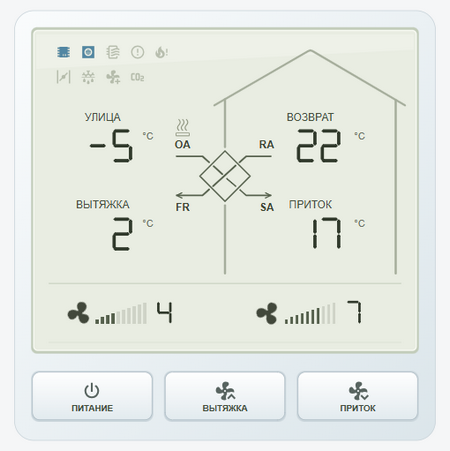

# Royal Clima ERV Card

[English](README.md)

Карточка для Home Assistant, предназначенная для отображения состояния и управления приточно-вытяжной установкой Royal Clima SOFFIO Primo с ESP32 и прошивкой ESPHome. Карточка находится в разработке; текущая тестовая версия показывает значение выбранного датчика. Прошивка, подключение оборудования и примеры дашбордов доступны в основном репозитории [ESPHome-RoyalClima](https://github.com/alidonet/ESPHome-RoyalClima).

Примеры карточек из репозитория прошивки:

