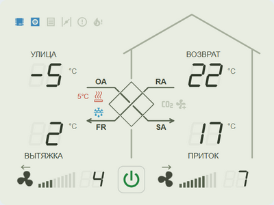
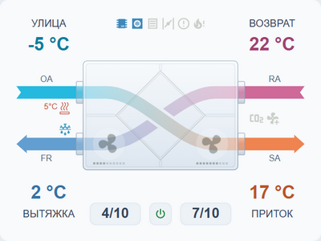
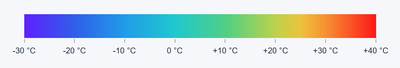

# Royal Clima ERV Card

[English](README.md)

Карточка Home Assistant для приточно-вытяжной установки Royal Clima SOFFIO Primo: температуры, состояния, управление питанием и ступенями вентиляторов. Два вида — пульт и схема потоков. Прошивка ESPHome для ESP32 и подключение оборудования: [ESPHome-RoyalClima](https://github.com/alidonet/ESPHome-RoyalClima).





## Установка

1. Подключите ESP32 с прошивкой к Home Assistant через интеграцию ESPHome.
2. В HACS откройте «Пользовательские репозитории», добавьте `https://github.com/alidonet/ha-royal-clima-card` с категорией **Dashboard** и установите **Royal Clima ERV Card**.
3. Если ресурс не добавился автоматически, добавьте в ресурсах дашбордов `/hacsfiles/ha-royal-clima-card/ha-royal-clima-card.js` с типом **JavaScript module**.
4. Обновите страницу браузера и добавьте карточку через выбор карточек или вручную в YAML.

Без HACS: скопируйте [dist/ha-royal-clima-card.js](dist/ha-royal-clima-card.js) в `/config/www/ha-royal-clima-card.js`, добавьте ресурс `/local/ha-royal-clima-card.js` с типом **JavaScript module** и обновите страницу.

## Минимальная конфигурация

Обязателен только `type`. Все остальные параметры и привязки сущностей опциональны.

```yaml
type: custom:royal-clima-card
```

## Полная конфигурация

Ниже — все параметры со значениями по умолчанию и явным выбором английского языка (`language: en`). Без `language` язык выбирается по профилю HA. Обычно достаточно минимального YAML или изменения префиксов. Явные `entities` имеют приоритет над префиксами: если копируете весь пример, меняйте и соответствующие entity_id.

```yaml
type: custom:royal-clima-card
view: control
prefix: ventilation_system
esp_prefix: royal_clima
transparent: false
flow_colormap: false
sensor_boost_co2: true

language: en

show_icons:
  esp_connection: true
  vent_system_online: true
  filter_usage: true
  bypass: true
  error: true
  fire_alarm: true
  preheater: true
  defrost: true
  sensor_boost: true
  external_input_boost: true

entities:
  uptime: sensor.royal_clima_uptime
  wifi_signal: sensor.royal_clima_wifi_signal
  seconds_since_last_data: sensor.ventilation_system_seconds_since_last_data
  offline_events: sensor.ventilation_system_offline_events
  fan_runtime: sensor.ventilation_system_fan_runtime
  filter_reminder_interval: sensor.ventilation_system_filter_reminder_interval
  ventilation_state: sensor.ventilation_system_ventilation_status
  error_description: sensor.ventilation_system_error_description
  humidity_setpoint: sensor.ventilation_system_humidity_setpoint
  heater_temperature_setpoint: sensor.ventilation_system_heater_temperature_setpoint
  outdoor_temperature: sensor.ventilation_system_outdoor_air_temperature
  return_temperature: sensor.ventilation_system_return_air_temperature
  exhaust_temperature: sensor.ventilation_system_exhaust_air_temperature
  supply_temperature: sensor.ventilation_system_supply_air_temperature
  exhaust_speed: sensor.ventilation_system_exhaust_fan_speed
  exhaust_speed_control: select.ventilation_system_exhaust_speed_control
  supply_speed_control: select.ventilation_system_supply_speed_control
  supply_speed: sensor.ventilation_system_supply_fan_speed
  power: binary_sensor.ventilation_system_ventilation_power
  power_control: switch.ventilation_system_ventilation_control
  vent_system_online: binary_sensor.ventilation_system_vent_system_online
  esp_connection: binary_sensor.royal_clima_esp32_connection
  error: binary_sensor.ventilation_system_ventilation_error
  fire_alarm: binary_sensor.ventilation_system_fire_alarm
  bypass: binary_sensor.ventilation_system_bypass_open
  defrost: binary_sensor.ventilation_system_defrost_active
  external_input_boost: binary_sensor.ventilation_system_external_input_boost_active
  sensor_boost: binary_sensor.ventilation_system_sensor_boost_active
  filter_usage: sensor.ventilation_system_filter_usage
  preheater: null
```

## Параметры

| Параметр | Значение / назначение |
|---|---|
| `type` | Обязательно: `custom:royal-clima-card`. |
| `view` | `control` — пульт, `airflow` — схема потоков. |
| `prefix`, `esp_prefix` | Префиксы сущностей ПВУ и ESP32: `ventilation_system`, `royal_clima`. Без домена; допустимы строчные латинские буквы, цифры и подчёркивания. |
| `language` | Не задан: русский для профиля HA с языком `ru` / `ru-*`, иначе английский. `ru` и `en` принудительно задают язык карточки; любая другая явно заданная строка, включая `auto`, выбирает английский. Прошивку и имена сущностей не меняет. |
| `transparent` | `false`; `true` убирает фон. Цвета текста и значков автоматически под тему не адаптируются. |
| `flow_colormap` | `false` — обычные цвета потоков; `true` — температурная палитра. |
| `sensor_boost_co2` | `true` — значок CO₂; `false` — значок влажности. Меняет оформление и подсказку, не определяет тип датчика. |
| `show_icons` | Все значки включены. Для скрытия задайте `false` нужному ключу из полного YAML; скрывается и область нажатия. Состояние сущности не меняется. |
| `entities` | Переопределения полными entity_id. Незаданные ключи формируются из префиксов; `null` отключает привязку. Ключи перечислены ниже. |

### Привязки entities

Домены и полные значения по умолчанию приведены в YAML выше. Показания и команды привязываются отдельно: `power_control` должен быть `switch`, а `*_speed_control` — `select` с числовыми строками ступеней `0`–`10`.

| Ключи в `entities` | Назначение |
|---|---|
| `outdoor_temperature`, `return_temperature`, `supply_temperature`, `exhaust_temperature` | Температуры улицы, возврата, притока и вытяжки. |
| `supply_speed`, `exhaust_speed` | Фактические ступени приточного и вытяжного вентиляторов, целые 0–10. |
| `supply_speed_control`, `exhaust_speed_control` | Выбор ступени притока и вытяжки. |
| `power`, `power_control` | Фактическое состояние питания и переключатель управления. |
| `esp_connection`, `vent_system_online` | Связь HA с ESP32 и ESP32 с ПВУ по Modbus. |
| `error`, `error_description`, `ventilation_state` | Признак ошибки, её описание и текстовый статус ПВУ. |
| `bypass`, `defrost`, `fire_alarm` | Открытый байпас, разморозка и пожарный вход. |
| `sensor_boost`, `external_input_boost` | Форсирование по датчику и внешнему входу. |
| `preheater`, `heater_temperature_setpoint` | Состояние предподогрева и уставка нагревателя. `preheater` по умолчанию не привязан (`null`). |
| `filter_usage`, `filter_reminder_interval`, `fan_runtime` | Использование фильтра в процентах, настроенный интервал напоминания и наработка вентилятора. |
| `humidity_setpoint` | Уставка влажности. |
| `uptime`, `wifi_signal`, `seconds_since_last_data`, `offline_events` | Время работы ESP32 в секундах, сигнал Wi-Fi, время с последних данных и число потерь связи; используются в подсказках. |

Если используются собственные обёртки управления, укажите их в `entities.power_control`, `entities.supply_speed_control`, `entities.exhaust_speed_control`. Отсутствующие дополнительные данные в подсказках пропускаются.

## Особенности отображения

- Отображение меняется при байпасе, недоступности или выключении установки, разморозке, предподогреве и форсировании. Скорость анимации вентиляторов зависит от их ступеней.
- Нажатие на температуру, индикатор или вентилятор открывает сведения о сущности и историю. В пульте цифры и шкала скорости открывают выбор ступени; в схеме потоков — нижние плашки. Изменение скорости доступно при включённой ПВУ и наличии связи; команды ожидают подтверждения до 20 секунд.
- Значок фильтра: менее 80 % — зелёный, от 80 до 100 % — оранжевый, от 100 % — красный. При отсутствии данных цвет не обозначает исправное состояние.
- Температурная палитра охватывает −30…+40 °C. За пределами диапазона ограничивается только цвет. При недоступной температуре на конце потока используются обычные цвета.


